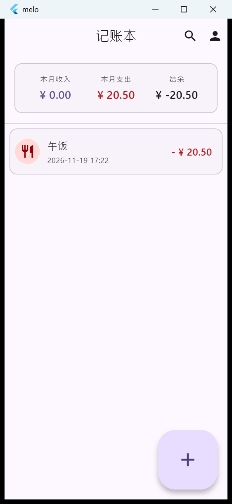
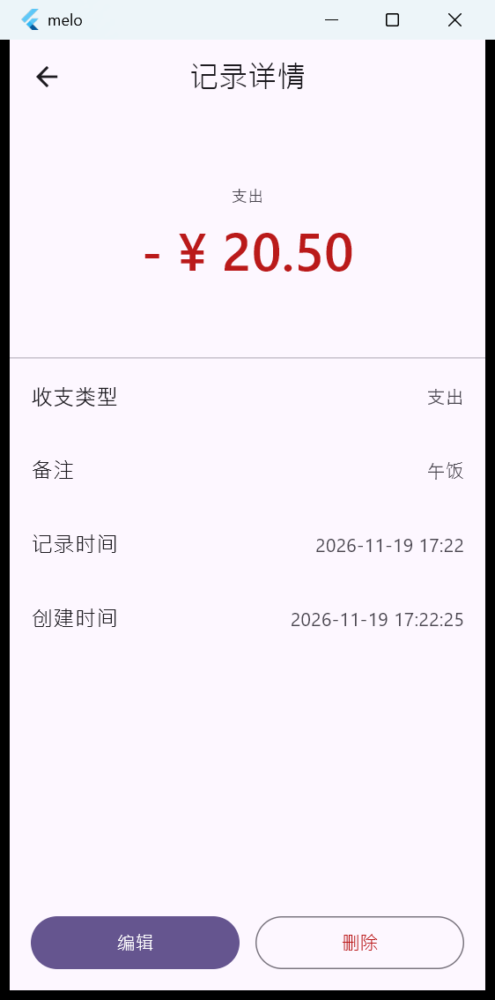
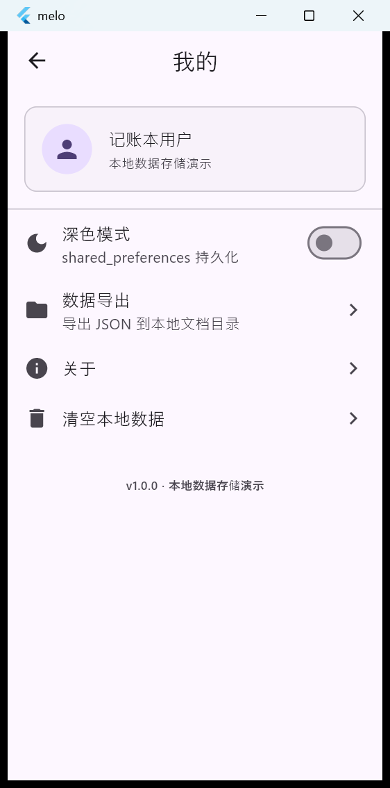

# 简易个人记账本（melo）

完全离线、数据只保存在本机的 Flutter 记账应用（Android / iOS / Windows）。
用于演示三种本地存储方式：**shared_preferences 键值存储、sqflite 数据库存储、文件存储**。

> 课程：移动软件开发 · 第 10 课「本地数据存储」

## 界面预览

<p align="center">
  
  &nbsp;
  
  &nbsp;
  
  <br/>
  <em>首页</em>&nbsp;&nbsp;&nbsp;&nbsp;<em>记录详情</em>&nbsp;&nbsp;&nbsp;&nbsp;<em>个人中心</em>
</p>

## 功能

- **首页**：本月收入 / 支出 / 结余统计，记账记录按时间倒序展示，右下角「记一笔」
- **记录详情**：金额大字展示，收支类型、备注、记录时间、创建时间，支持编辑与删除
- **个人中心**：深色模式开关、数据导出、关于、清空本地数据
- **完全离线**：不联网、不注册账号，所有数据只写在本机

## 三种本地存储

| 存储方式 | 存什么 | 键 / 表 / 文件 | 界面入口 |
|---|---|---|---|
| shared_preferences | 深色模式配置 | `isDarkMode` | 个人中心 · 深色模式 |
| sqflite (SQLite) | 记账流水 | 表 `book_record` | 首页列表 / 详情页 / 清空数据 |
| 文件存储 | 全量记录导出 | `record_export.json`（文档目录） | 个人中心 · 数据导出 |

数据库建表：

```sql
CREATE TABLE book_record(
  id       INTEGER PRIMARY KEY AUTOINCREMENT,
  type     INTEGER NOT NULL,   -- 0 支出，1 收入
  amount   REAL    NOT NULL,
  remark   TEXT,
  createAt TEXT    NOT NULL    -- yyyy-MM-dd HH:mm:ss
);
```

`createAt` 统一用 `yyyy-MM-dd HH:mm:ss`，字符串排序等价于时间排序，按月统计直接 `createAt LIKE '2026-11%'`。

## 代码结构

```
lib/
├── main.dart              入口与主题
├── models/record.dart     Record 模型 + toMap / fromMap
├── db/db_helper.dart      数据库单例：建表、CRUD、搜索、统计、迁移
├── services/              theme_service（SP）、file_service（文件）
├── utils/date_util.dart   时间格式化
└── pages/                 首页 / 详情 / 个人中心
```

`pages` 只做渲染与交互，`db` / `services` 封装存储并对外提供 `Future` 接口。

## 开发

```bash
flutter pub get
flutter run                 # Android / iOS
flutter run -d windows      # Windows 桌面（已适配 sqflite FFI）
```

依赖：`sqflite`、`shared_preferences`、`path_provider`、`path`；桌面端调试额外使用 `sqflite_common_ffi` + `sqlite3 2.x`，在 `main()` 中按平台切换 `databaseFactory`，Android / iOS 不受影响。

实现要点：

- 主题在 `initState` 异步读取并 `?? false` 兜底，不在 `build` 中同步读 shared_preferences
- 所有 sqflite 调用均 `await`，拿到结果后再 `setState`
- 搜索与筛选使用 `whereArgs` 参数化，不拼接 SQL 字符串
- 文件写 `getApplicationDocumentsDirectory()` 持久目录，读写均有异常捕获

## 隐私

记账数据只保存在本机，应用不申请网络权限、不上传任何数据。卸载应用或清除本地数据后，记录不可恢复。
